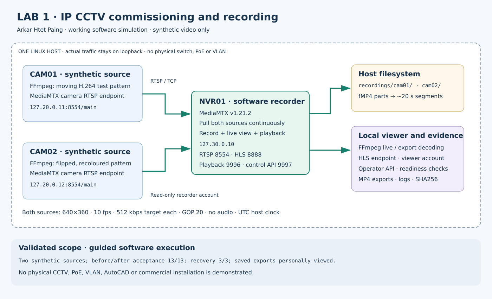

# Linux Service Verification Lab for IT Support

**Arkar Htet Paing · Junior IT Support portfolio · Yangon, Myanmar**

A guided software lab for checking **service availability, access permissions, saved output and recovery**. It uses two synthetic video sources and a local software recorder to make those checks observable and repeatable.

I personally ran the documented commissioning procedure on Kali Linux, reviewed its results and played both exported recordings. This project supports my preparation for **junior IT Support**, including the care needed to confirm that a service is usable after a fault.

**[Project overview](projects/ip-cctv-recording/README.md) · [Recorded evidence](projects/ip-cctv-recording/evidence/README.md) · [My contribution](projects/ip-cctv-recording/docs/CONTRIBUTION_AND_SCOPE.md) · [Implementation guide](projects/ip-cctv-recording/docs/IMPLEMENTATION.md)**

## Why this exercise matters

A service can appear available while its saved output, permissions or recovery behaviour still need attention. This lab separates those questions:

- Can each source deliver decodable live video?
- Does the recorder save an interval that can actually be retrieved and decoded?
- Are invalid credentials and unauthorized actions rejected?
- Does the unaffected source remain available when the other source stops?
- After a recorder restart, are settled old files preserved and usable new recordings created?

These are service-verification habits that transfer to IT Support. The implementation here is a local video-service exercise; banking systems are outside its scope.

## Architecture and technologies



| Component | Implementation |
|---|---|
| **Source video** | FFmpeg-generated test patterns; two separate synthetic streams. |
| **Streaming and recording** | MediaMTX endpoints for source delivery, recording, viewing and playback/export. |
| **Orchestration and checking** | Python procedure for setup, process control, acceptance checks and controlled recovery. |
| **Environment** | One Linux x86_64 machine, with services bound to loopback addresses. |
| **Evidence** | JSON reports, a CSV check table, command/decoder logs and two exported MP4 files. |

The recorded environment used **MediaMTX v1.21.2** and **FFmpeg 7.0.2-static**. The [tool reference manifest](projects/ip-cctv-recording/tools/reference-manifest.json) records the actual acquisition references and hashes.

## Recorded results

| Stage | Outcome | Evidence |
|---|---|---|
| **Initial acceptance** | **13/13 checks passed** | [Before-recovery report](projects/ip-cctv-recording/evidence/before-recovery.json) |
| **Controlled recovery** | **3/3 checks passed** | [Fault/recovery report](projects/ip-cctv-recording/evidence/fault-recovery.json) |
| **Post-recovery acceptance** | **13/13 checks passed** | [After-recovery report](projects/ip-cctv-recording/evidence/after-recovery.json) |
| **Saved exports** | Both five-second exports decoded to 50 frames each. I also personally viewed both files and observed changing test patterns. | [Evidence guide and video links](projects/ip-cctv-recording/evidence/README.md) |
| **Overall commissioning** | Passed; the procedure stopped its own lab processes afterwards. | [Commissioning result](projects/ip-cctv-recording/evidence/commissioning-result.json) |

The initial and post-recovery stages repeat the **same 13-check acceptance matrix**. The [29-row CSV](projects/ip-cctv-recording/evidence/test-results.csv) contains those two stages plus the three recovery checks.

### What was verified

- Source readiness, live decoding, recorded intervals and exported-video decoding were checked separately.
- Invalid passwords, a wrong path and viewer attempts to publish or access the control API were rejected as expected.
- During Source 1's controlled outage, Source 2 remained ready and its live video decoded. The recorder's index also remained available for review.
- After Source 1 recovered, decoding resumed. A recorder restart preserved the hashes of settled old files and produced new decodable recordings for both sources.
- The service-binding check confirmed loopback listeners in the recorded environment.

The [implementation guide](projects/ip-cctv-recording/docs/IMPLEMENTATION.md) explains how the checks distinguish a successful result from a superficial HTTP or live-status response.

## My contribution

I personally executed the commissioning procedure, reviewed the reports, checked both exported recordings in a media player and explained the difference between live availability and usable saved output. The [contribution record](projects/ip-cctv-recording/docs/CONTRIBUTION_AND_SCOPE.md) preserves those observations and their scope.

Configuration, fault injection and acceptance checks are automated by the supplied procedure. These results establish guided execution and review; independent automation authorship and diagnosis of unfamiliar faults are not established. Source provenance and original attribution are retained.

## Inspect the implementation

| Resource | What to review |
|---|---|
| [lab.py](projects/ip-cctv-recording/lab.py) | Setup, process ownership, service checks, controlled faults and final commissioning result. |
| [Evidence guide](projects/ip-cctv-recording/evidence/README.md) | How to interpret reports, logs and exported recordings. |
| [Implementation guide](projects/ip-cctv-recording/docs/IMPLEMENTATION.md) | Tested environment, endpoints, reproduction and troubleshooting notes. |
| [Command journal](projects/ip-cctv-recording/logs/commands.jsonl) | Recorded commands from the published run, with local paths redacted. |
| [verify_evidence.py](verify_evidence.py) and [SHA256SUMS.txt](SHA256SUMS.txt) | Read-only checks of the published manifest, stage results, referenced logs and export hashes. |

For an initial review, open the contribution statement, recovery report and one exported video. They give a concise view of my involvement, the tested behaviour and the actual saved output.

## Reproduce in a separate workspace

Use an authorized **Linux x86_64** learning machine with Python 3 and the documented FFmpeg/MediaMTX tools. The executables are not bundled in this repository. The [implementation guide](projects/ip-cctv-recording/docs/IMPLEMENTATION.md) explains tool selection and the optional pinned downloader.

Keep the published evidence intact. Copy `lab.py`, `bootstrap.py` and the selected tool files into a **fresh run folder** as described in that guide. From the fresh folder:

```sh
python3 -B lab.py setup
python3 -B lab.py commission
```

Setup generates private local configuration and credentials. Commission runs the acceptance and recovery stages and writes new evidence. Inspect the results, decode and personally view your new exports, and preserve any genuine failure for investigation. Use synthetic data and keep generated credentials/configuration private. Run one instance at a time because the endpoints use fixed local addresses.

## Scope and development priorities

The sources and recorder are software processes on one machine. Physical cameras, NVR appliances, cabling, managed-switch VLANs and commercial CCTV installation were not tested. RTSP/HTTP remain unencrypted on loopback; this is a local learning configuration.

The next learning priorities are explaining service dependencies without the script, diagnosing a changed fault and writing a concise incident/handover record. These are future exercises rather than additional completed results.

The historical repository name reflects an earlier learning plan. This README presents the implemented work as **service-verification evidence for junior IT Support**. Published run records, timestamps and attribution remain unchanged.

**[About me and my IT Support portfolio](https://github.com/arkarhtetpaing23) · [Network connectivity lab](https://github.com/arkarhtetpaing23/singapore-infrastructure-operations-labs)**
