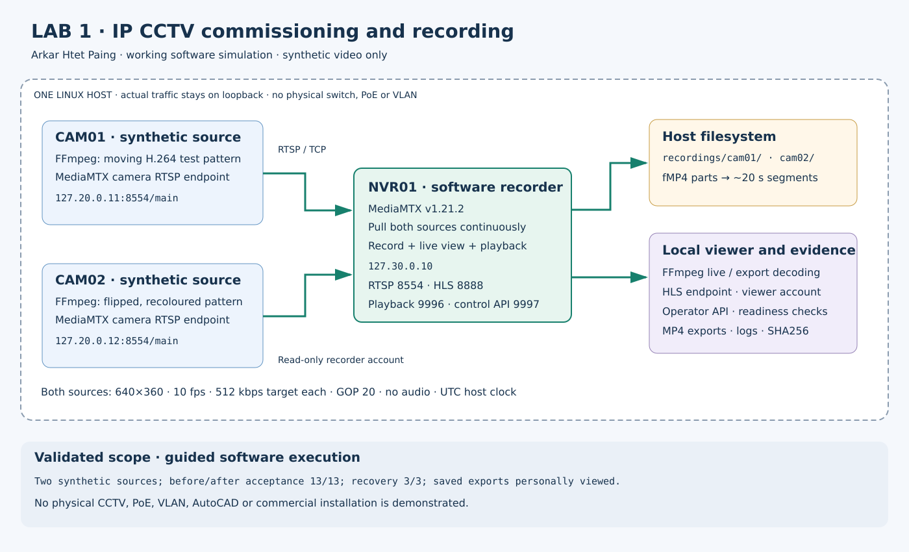

# IP CCTV recording, permissions and recovery

**Guided personal software lab · Kali Linux · Two synthetic video sources · Validated 14 October 2026 local date**

This project demonstrates how two generated video sources reach a software recorder, become recordings and produce playable exports. It also tests viewer restrictions and recovery from a camera-source outage and recorder restart.

## Why this matters for pre-sales

A technical demonstration should establish more than a working live picture. The customer also needs evidence that recording, retrieval and access restrictions work. This lab lets me explain those separate functions and show controlled fault behaviour. It supports introductory demonstration and documentation skills; commercial product selection, installation, cabling, electrical safety and production design are outside its scope.

## Architecture

Both camera endpoints and the recorder run on one laptop. FFmpeg generates video; MediaMTX provides the authenticated stream endpoints, recording and playback. The loopback addresses identify separate local processes, not physical cameras or segmented switch networks. RTSP and HTTP here are unencrypted and remain on loopback.

## Results from my guided run

| Stage | Result | What was checked |
|---|---|---|
| Before recovery | 13/13 PASS | Source readiness, live decoding, authentication, viewer restrictions, recorded intervals, exports and loopback bindings |
| Controlled failures/recovery | 3/3 PASS | Camera 1 outage isolation, automatic camera-source recovery, recorder restart preserving old files and resuming decodable recordings |
| After recovery | 13/13 PASS | Repeat the acceptance matrix after the faults |
| Saved video decoding | Both PASS | Each five-second export decoded to 50 frames; file hashes match the final report |
| Personal visual playback | Candidate confirmed | Both files played with changing test patterns; this is a personal observation rather than an automated player result |

The overall procedure returned `COMMISSIONING PASS` and stopped its own lab processes. Camera 2 remained ready and its video decoded during Camera 1's outage. Its recording index spans that outage; Camera 1's index contains a gap. Buffering means the recorded-gap boundary need not match the exact source-stop instant.

The before and after stages repeat the same 13-check matrix. They are not 26 different features. Wrong-password rejection is an expected successful security check, although the request itself fails.

## Review the evidence

- [Evidence index and interpretation](evidence/README.md).
- [Machine-readable final results](evidence/after-recovery.json), [recovery results](evidence/fault-recovery.json), and [complete 29-row stage/check table](evidence/test-results.csv).
- [Camera 1 exported video](evidence/videos/cam01-verified.mp4) and [Camera 2 exported video](evidence/videos/cam02-verified.mp4). Download and open in a compatible player if the repository viewer does not play them.
- [Implementation and test procedure](docs/IMPLEMENTATION.md).
- [My contribution and explanation](docs/CONTRIBUTION_AND_SCOPE.md).
- [Pre-sales demonstration and handover brief](docs/PRESALES_BRIEF.md).
- Reviewed [lab source](lab.py), [optional portable-tool downloader](bootstrap.py), and [tool reference manifest](tools/reference-manifest.json).

## Limits

No physical IP camera, NVR appliance, PoE switch, cable, ONVIF discovery, DHCP server, managed-switch VLAN, night image, physical storage retention, access-control system, public-address system or AutoCAD drawing was tested. The human test covered saved exports; browser live-view playback and unfamiliar-fault troubleshooting have not been personally assessed. This is not proof of independent production deployment capability.

The AI-assisted source was prepared and reviewed before my run. I personally executed the guided procedure and validated the described outputs. See the exact contribution statement before interpreting any result as independently authored work.
